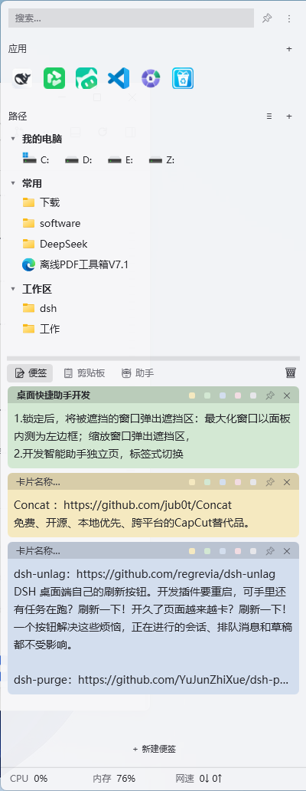
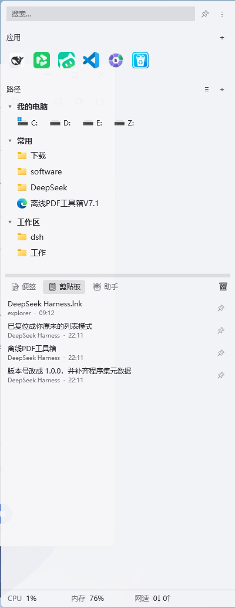
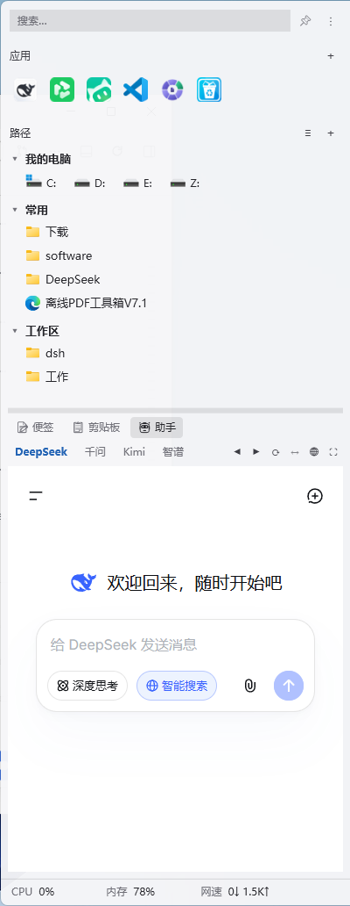

# QuickDrawer

Windows 右侧悬浮侧边栏——常用目录、应用快捷方式、便签、剪贴板历史四合一，外加内嵌 AI 助手与划词选区。

**不装运行时**——目标 .NET Framework 4.8 是 Windows 系统组件，目标机器无需安装任何东西。不写注册表（除了可选的开机自启），数据全部留在本机。

**许可证**：[MIT](LICENSE)　**版本**：1.0.3　**平台**：Windows 10 21H2+ / Windows 11，仅 x64

---

## 功能

| 模块 | 能做什么 |
|---|---|
| **目录快捷方式** | 把常用文件夹钉在面板里，按分类分组，支持拖拽重排、跨分类拖动、列表/网格两种布局；**图标高度跟随字号**，与文字齐平，「我的电脑」里的盘符图标保持原尺寸 |
| **应用快捷方式** | 拖 exe 或 `.lnk` 进面板即成磁贴，自动取系统图标；从开始菜单批量导入 |
| **便签** | 卡片式多便签，5 色标签、置顶、即时保存；每张卡片的**标题栏比正文底色深一档**且只占 22px 细条，标题与内容一眼分得开又不占地方；正文字号可在设置里 10–20 调节 |
| **剪贴板历史** | 文本 / HTML / RTF / 图片 / 文件五种格式，搜索、固定、写回剪贴板；**Word / Excel 表格粘回去仍是表格**；只给 ANSI 文本的老程序也能记到；划词/助手用完会**把自己写进剪贴板的内容还原**，但检测到剪贴板已被别人改过就放弃还原，不覆盖你刚复制的东西；内容 DPAPI 加密落盘 |
| **智能助手** | 内嵌 WebView2 打开 DeepSeek / Kimi / 智谱清言 / 通义千问网页端，免登录切换；加宽面板时**缩放上限固定 1.0**，只把小号站点补到 1.0，不会把字放大 |
| **底部仪表盘** | 面板最下一行常驻显示 CPU / 内存 / 网速，点击 CPU 打开任务管理器 |
| **划词选区** | 鼠标拖选文字后弹出发送条，一键把选中内容送进助手并附预设提示词 |
| **不抢焦点、不折腾布局** | 面板收起、取消固定时**不再把被弹开的窗口挪回原位**，桌面保持你当前的布局；也不会激活你已最小化的窗口，收起前把前台交还给你原来的窗口 |
| **应用图标** | 深色圆角底 + 金黄竖条 + 三条内容线，16px 下仍清晰；托盘与 exe 文件图标同一套图形 |

**交互**：鼠标移到屏幕右边缘滑出，或按 `Win+Alt+N`；托盘常驻，双击唤出。

### 界面

三个底部标签页，面板宽度 400px（可拖拽 300–560）：

| 便签 | 剪贴板 | 助手 |
|---|---|---|
|  |  |  |

上半部分（搜索 / 应用 / 路径）在所有标签页常驻，最下面一行是 CPU / 内存 / 网速仪表盘，点击 CPU 打开任务管理器。

---

## 使用方法

### 启动

双击 `QuickDrawer.exe`。首次运行会在 `%APPDATA%\QuickDrawer\` 下建配置和数据文件。程序常驻托盘，单实例——重复启动会提示已在运行。

### 唤出

- **鼠标**：移到屏幕**右边缘**，抽屉滑出
- **热键**：`Win+Alt+N`（若被占用会自动降级到备用组合，设置页会显示实际生效的键）
- **托盘**：双击图标

### 添加内容

- **目录**：点面板里的「+」选文件夹，或直接把文件夹拖进来
- **应用**：把 exe / `.lnk` 拖到应用区；也可用「从开始菜单导入」
- **便签**：点「＋ 新建便签」
- **剪贴板**：自动记录，无需操作

### 划词选区

在任意程序里拖选一段文字，会弹出发送条。选一个预设提示词（翻译 / 解释 / 润色 / 改写），选中内容会被送进助手当前站点。

> 在终端窗口（cmd / PowerShell / Windows Terminal 等）中拖选**不会**触发——那里 `Ctrl+C` 是中断信号，误触会打断正在运行的命令。

---

## 隐私与数据

所有数据只存在本机 `%APPDATA%\QuickDrawer\`：

| 文件 | 内容 |
|---|---|
| `config.json` | 设置项 |
| `shortcuts.json` | 目录 / 应用快捷方式 |
| `notes.json` | 便签 |
| `clipboard.json` | 剪贴板历史（**内容 DPAPI 加密**） |
| `blobs/` | 剪贴板图片数据 |
| `logs/diag.log` | 诊断日志（上限 2 MB，超出自动轮转） |

**没有遥测，没有联网上报，没有账号。** 唯一的网络访问是你主动使用的 AI 助手页面——那是 WebView2 加载的站点网页，走该站点自己的隐私政策。

### 剪贴板加密的边界

剪贴板条目的**正文**（文本、预览、文件列表、来源应用）用 Windows DPAPI 以 `CurrentUser` 作用域加密，密文拷到别的机器或别的用户下解不开。

明文保留的只有元数据：条目 ID、类型、大小、时间戳、是否固定。这些不含用户内容，但让文件在别的机器上仍可被读取结构。

日志方面：**诊断日志从不记录剪贴板正文、不记录选中文本、不记录完整路径**，用户目录会被替换成 `%USER%`。可以设 `config.json` 里的 `diagLogEnabled: false` 完全关掉。

### 关于助手页的发送保护

划词发送前会校验当前页面是否仍属于该助手的官方域名。如果页面被导航到别的站点（比如点了网页里的外链），发送会被取消并在界面上提示——避免把选中的文字误发到第三方网站。

你自己在页面里手动输入不受这个限制。

---

## 诊断

抽屉窗口是 `WS_EX_NOACTIVATE` 且可能定位到屏幕外，外部工具读 `MainWindowHandle` / `MainWindowTitle` 常拿不到值。程序自己把状态写进：

```
%APPDATA%\QuickDrawer\logs\diag.log
```

排查"窗口没反应 / 看起来没启动"时先看它，里面有 hwnd、工作区矩形、Left/Top/Height、展开状态、热键注册结果。

日志超过 2 MB 会轮转为 `diag.log.1`（只保留一份），不会无限增长。

检查热键是否被别的程序占用：

```powershell
powershell -NoProfile -ExecutionPolicy Bypass -File probe\diag-hotkey.ps1
```

---

## 构建

需要 .NET SDK（构建 net48 需要 .NET Framework 4.8 Developer Pack 或参考程序集包，已通过 `Microsoft.NETFramework.ReferenceAssemblies` 自动获取）。

```powershell
# 调试构建
dotnet build QuickDrawer.sln -c Release

# 发布前必须先关掉正在运行的实例，否则 exe 被占用会导致发布失败
Get-Process QuickDrawer -ErrorAction SilentlyContinue | Stop-Process -Force

# 发布（框架依赖，输出一个文件夹）
dotnet publish src\QuickDrawer\QuickDrawer.csproj -c Release -o <发布目录>
```

> ⚠️ **不要把产物发布到项目工作区目录内测试**。本项目开发时工作区被工具加了 `Everyone Deny DeleteSubdirectoriesAndFiles` 的沙箱 ACE，继承到整棵子树后，从这里启动的 .NET Framework 进程在部分机器上会写不了 `%APPDATA%` 下的日志（表现为程序能跑但 `diag.log` 一字不增；助手页 WebView2 也初始化失败，报 `COMException: 请求的资源在使用中 (0x800700AA)`；最严重时以 `0xE0434352` 直接退出）。发布到工作区外即可，与程序本身无关。

### 已知的构建约束

这几项都是实测踩过的坑，改动前请先读 csproj 里的注释：

| 设置 | 不能这么做的原因 |
|---|---|
| 缺 `PlatformTarget=x64` | NuGet 按默认 x86 挑原生资源，产物里会塞进 32 位 `WebView2Loader.dll`，64 位进程加载它抛 `BadImageFormatException (0x8007000B)`，**只有助手页挂，其他功能全正常**，极易误判成 WebView2 坏了。`<Platforms>x64</Platforms>` 只是"本工程可构建哪些平台"的声明，不决定编译目标 |
| `InvariantGlobalization=true` | WPF 数据绑定在 `BindingExpressionBase.GetCulture()` 需要 `CultureInfo`，会抛 `Cannot find non-neutral culture related to 'en-us'.`，程序在 `Show()` 时崩溃 |
| 显式引用 `System.Security.Cryptography.ProtectedData` | 该包随 Windows Desktop SDK 自动提供，显式引用触发 `NU1510` |

`.lnk` 解析依赖 COM interop（`IShellLinkW`），所以 `EnableComInterop` 必须为 `true`。

**判断产物架构别用错工具**：PE 头的 COFF machine 字段对 AnyCPU 程序集恒为 `0x14c`，看着像 x86 其实不是。要读 COR20 header 的 Flags（`ILONLY=0x1` / `BIT32_REQUIRED=0x2` / `BIT32_PREFERRED=0x10000`）。仓库里有现成脚本：

```powershell
python probe/_pe_platform.py <发布目录>\QuickDrawer.exe <发布目录>\WebView2Loader.dll
```

---

## 目录结构

```
src/QuickDrawer/          WPF 项目
  Native/                 Win32 P/Invoke
  Assistant/              WebView2 助手服务
  Selection/              划词选区与截图
  Themes/                 深色 / 浅色主题资源
  assets/                 应用图标
  DrawerWindow.xaml       主抽屉界面
  App.xaml.cs             启动、单实例、异常兜底、配置存储
probe/                    Win32 机制验证探针（PowerShell / Python，开发期产物）
docs/                     设计文档、修正记录与 README 截图
CHANGELOG.md              对使用者可见的版本变化
```

---

## 设计文档

- [`docs/可行性方案.md`](docs/可行性方案.md) —— 完整技术方案：平台机制验证数据、拖拽重排算法的三代演进、性能实测、决策记录
- [`docs/修正记录.md`](docs/修正记录.md) —— 发布前审查发现的问题与逐项修正过程

---

## 致谢与状态

这个项目目前处于 **v1.0.0**，功能完整但未经大规模用户验证。如果你发现问题，欢迎开 issue——**提交日志前请先看一遍内容**，虽然程序已做脱敏，检查一下总没错。

### 架构上已知的欠账

诚实说明：主窗口 `DrawerWindow.xaml.cs` 有 3,800 行，是典型的 God Class，承担了布局、拖拽、动画、面板、托盘菜单、持久化等职责。功能上没问题，但后续维护和贡献会因此变难。

拆分成 12 个职责单一的类是可做的，只是需要配套回归验证，所以没有放在 1.0.0 里做。这是已知的技术债，不是疏忽。
